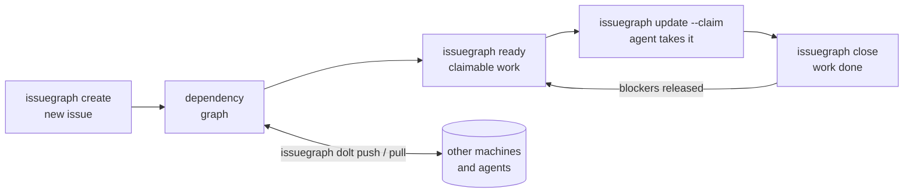

<p align="center">
  
</p>

# IssueGraph

**Distributed graph issue tracker for AI agents, powered by [Dolt](https://github.com/dolthub/dolt).**

**Platforms:** macOS, Linux, Windows

[](LICENSE)
[](https://goreportcard.com/report/github.com/borg0ai/dx-issuegraph)
[](https://github.com/borg0ai/dx-issuegraph/releases)
[](https://pypi.org/project/issuegraph-mcp/)

**Docs:** https://github.com/borg0ai/dx-issuegraph/tree/main/docs/

IssueGraph provides a persistent, structured memory for coding agents. It replaces messy markdown plans with a dependency-aware graph, allowing agents to handle long-horizon tasks without losing context.



## ⚡ Quick Start

```bash
# Install issuegraph CLI first (see Installation below; don't clone this repo into your project)

# Initialize in YOUR project
cd your-project
issuegraph init

# Optional: refresh or install richer instructions for your agent
issuegraph setup codex    # Codex CLI - installs skill, AGENTS.md guidance, and hooks
issuegraph setup claude   # Claude Code - installs hooks/settings
issuegraph setup factory  # Factory.ai Droid - creates/updates AGENTS.md
```

**Note:** IssueGraph is a CLI tool you install once and use everywhere. You don't need to clone this repository into your project.

`issuegraph init` creates or updates `AGENTS.md` by default so agents can discover the issuegraph workflow, and also installs project Claude/Codex integrations unless you pass `--skip-agents` or `--stealth`. Use `issuegraph setup --list` to see supported integrations, including `issuegraph setup codex`, `issuegraph setup factory`, `issuegraph setup claude`, `issuegraph setup mux`, `issuegraph setup cursor`, and more. See [Agent and IDE setup](docs/getting-started/ide-setup.md).

Manual copy-paste is only for unsupported agents, existing projects where you cannot rerun `issuegraph init`/`issuegraph setup`, or custom instruction files. In those cases, run `issuegraph onboard` and paste the printed snippet into the file your agent reads.

If your agent is not covered by `issuegraph setup`, add this minimal `AGENTS.md` section:

```markdown
This project uses issuegraph (IssueGraph) for issue tracking.

- Run `issuegraph prime` for workflow context and command guidance.
- Use `issuegraph ready`, `issuegraph show <id>`, `issuegraph update <id> --claim`, and `issuegraph close <id>`.
- Use `issuegraph remember "insight"` for persistent project memory; do not create MEMORY.md files.
- Do not use markdown TODO lists for task tracking.
```

## 🛠 Features

* **[Dolt](https://github.com/dolthub/dolt)-Powered:** Version-controlled SQL database with cell-level merge, native branching, and built-in sync via Dolt remotes.
* **Agent-Optimized:** JSON output, dependency tracking, and auto-ready task detection.
* **Zero Conflict:** Hash-based IDs (`issuegraph-a1b2`) prevent merge collisions in multi-agent/multi-branch workflows.
* **Compaction:** Semantic "memory decay" summarizes old closed tasks to save context window.
* **Messaging:** Message issue type with threading (`--thread`), ephemeral lifecycle, and mail delegation.
* **Graph Links:** `relates-to`, `duplicates`, `supersedes`, and `replies-to` for knowledge graphs.

## 📖 Essential Commands

| Command | Action |
| --- | --- |
| `issuegraph ready` | List tasks with no open blockers. |
| `issuegraph create "Title" -p 0` | Create a P0 task. |
| `issuegraph update <id> --claim` | Atomically claim a task (sets assignee + in_progress). |
| `issuegraph dep add <child> <parent>` | Link tasks (blocks, related, parent-child). |
| `issuegraph show <id>` | View task details and audit trail. |
| `issuegraph prime` | Print agent workflow context and persistent memories. |
| `issuegraph remember "insight"` | Store project memory that `issuegraph prime` injects later. |

## 🔗 Hierarchy & Workflow

IssueGraph supports hierarchical IDs for epics:

* `issuegraph-a3f8` (Epic)
* `issuegraph-a3f8.1` (Task)
* `issuegraph-a3f8.1.1` (Sub-task)

**Stealth Mode:** Run `issuegraph init --stealth` to use IssueGraph locally without committing files to the main repo. Perfect for personal use on shared projects. See [Git-Free Usage](#-git-free-usage) below.

**Contributor vs Maintainer:** When working on open-source projects:

* **Contributors** (forked repos): Run `issuegraph init --contributor` to route planning issues to a separate repo (e.g., `~/.issuegraph-planning`). Keeps experimental work out of PRs.
* **Maintainers** (write access): IssueGraph auto-detects maintainer role via SSH URLs or HTTPS with credentials. Only need `git config issuegraph.role maintainer` if using GitHub HTTPS without credentials but you have write access.

## 📦 Installation

Install through the package manager for your OS. IssueGraph is not distributed any other way.

**macOS (Homebrew):**

```bash
brew install systembugtj/luban-homebrew/issuegraph
```

**Linux (Nix):**

```bash
nix profile install github:systembugtj/cangjie-nix#issuegraph
```

**Windows (Scoop):**

```powershell
scoop bucket add shennong https://github.com/systembugtj/shennong-bucket
scoop install shennong/issuegraph
```

Each channel installs the matching archive from the tagged GitHub Release and pins its SHA-256 from the release `SHA256SUMS`.

**Upgrading?** Replacing the binary is not always the whole story. Short
version: sync remote-backed databases with your current `issuegraph`, back up with
`issuegraph export --all`, upgrade the binary, then run `issuegraph info --whats-new`,
`issuegraph hooks install`, and `issuegraph version`. If the upgrade crosses a schema
migration on a remote-backed database, exactly one designated clone runs
`issuegraph migrate` and `issuegraph dolt push`; other clones install the new binary
and run `issuegraph bootstrap`. See the full
[upgrade guide](https://github.com/borg0ai/dx-issuegraph/tree/main/docs/getting-started/upgrading).

See [docs/reference/antivirus.md](docs/reference/antivirus.md) for Windows AV false-positive guidance and verification workflow.

## 💾 Storage Modes

IssueGraph uses [Dolt](https://github.com/dolthub/dolt) as its database. Two modes:

- **Embedded (default)** — `issuegraph init`. Dolt runs in-process, data lives in
  `.issuegraph/embeddeddolt/`, single writer. Recommended for most users.
- **Server** — `issuegraph init --server`. Connects to an external `dolt sql-server`
  for multiple concurrent writers; data lives in `.issuegraph/dolt/`.

Every write also refreshes a complete snapshot, `.issuegraph/issues.jsonl` plus
`.issuegraph/manifest.json`, which Git tracks. To move issues to another clone,
commit and push those two files with Git yourself, then run
`issuegraph snapshot restore` there: it validates the manifest and makes the local
database equal to the snapshot, deleting issues the snapshot no longer lists.
IssueGraph itself never runs Git or contacts a remote for this. Turn the snapshot
off with `issuegraph config set export.auto false`. Back up and migrate between
modes with `issuegraph backup`; reclaim space with `issuegraph prune` /
`issuegraph purge`.

Full detail — connection flags, sockets, maintenance, backup, and migration —
in the [Dolt backend guide](docs/architecture/dolt.md).

### Schema Version Guard

`issuegraph` checks the database schema version at open time. If the database has been
migrated by a newer binary and an older binary tries to open it, `issuegraph` exits
with an actionable error rather than issuing queries that fail with cryptic SQL
errors:

````
schema version mismatch: database is at v45, binary knows up to v42 (3 migrations ahead)

  Your issuegraph binary is stale. Queries for dropped or renamed columns will fail
  with cryptic SQL errors (e.g. "column X could not be found in any table in scope").

  Rebuild from main:
    CGO_ENABLED=0 go build -tags gms_pure_go ./apps/cli

  Or upgrade to the latest release through your package manager:
    brew upgrade issuegraph | nix profile upgrade issuegraph | scoop update issuegraph

  To proceed despite the risk (some read commands may still work):
    ISSUEGRAPH_IGNORE_SCHEMA_SKEW=1 issuegraph <command>
    issuegraph --ignore-schema-skew <command>
````

**When this fires:** only when the database schema is *ahead* of the binary
(a newer binary migrated the database; this binary doesn't know those
migrations). Normal upgrades, where the binary migrates the database forward,
are unaffected.

**Escape hatch:** `ISSUEGRAPH_IGNORE_SCHEMA_SKEW=1` (or `--ignore-schema-skew`) bypasses
the guard with a warning on stderr. Use this only if you know the forward
migrations are additive and safe for your specific workload.

## 🌐 Community Tools

See [docs/community-tools.md](docs/community-tools.md) for a curated list of community-built UIs, extensions, and integrations—including terminal interfaces, web UIs, editor extensions, and native apps.

See [docs/related-projects.md](docs/related-projects.md) for adjacent or complementary projects that solve different problems in the same neighborhood.

## 🚀 Git-Free Usage

IssueGraph works without git. The Dolt database is the storage backend — git
integration (hooks, repo discovery, identity) is optional.

```bash
# Initialize without git
export ISSUEGRAPH_DIR=/path/to/your/project/.issuegraph
issuegraph init --quiet --stealth

# All core commands work with zero git calls
issuegraph create "Fix auth bug" -p 1 -t bug
issuegraph ready --json
issuegraph update issuegraph-a1b2 --claim
issuegraph prime
issuegraph close issuegraph-a1b2 "Fixed"
```

`ISSUEGRAPH_DIR` tells issuegraph where to put the `.issuegraph/` database directory,
bypassing git repo discovery. `--stealth` sets `no-git-ops: true` in
config, disabling all git hook installation and git operations.

This is useful for:
- **Non-git VCS** (Sapling, Jujutsu, Piper) — no `.git/` directory needed
- **Monorepos** — point `ISSUEGRAPH_DIR` at a specific subdirectory
- **CI/CD** — isolated task tracking without repo-level side effects
- **Evaluation/testing** — ephemeral databases in `/tmp`

## 📝 Documentation

* [Documentation site](https://github.com/borg0ai/dx-issuegraph/tree/main/docs/) | [Installing](docs/getting-started/installation.md) | [Sync Concepts](docs/core-concepts/sync-concepts.md) | [Agent Workflow](AGENT_INSTRUCTIONS.md) | [Copilot CLI Setup](docs/integrations/copilot-cli.md) | [Copilot VS Code MCP](docs/integrations/github-copilot.md) | [Articles](ARTICLES.md) | [Sync Branch Mode](docs/reference/protected-branches.md) | [Troubleshooting](docs/reference/troubleshooting.md) | [FAQ](docs/reference/faq.md)
* [](https://deepwiki.com/borg0ai/dx-issuegraph)
