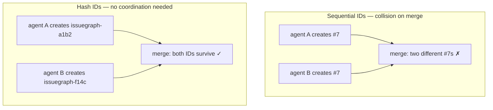

Understanding issuegraph's collision-resistant ID system.

## The Problem

Traditional sequential IDs (`#1`, `#2`, `#3`) break when:
- Multiple agents create issues simultaneously
- Different branches have independent numbering
- Forks diverge and later merge



## The Solution

IssueGraph uses hash-based IDs:

```
issuegraph-a1b2c3    # Short hash
issuegraph-f14c      # Even shorter
issuegraph-a3f8e9.1  # Hierarchical (child of issuegraph-a3f8e9)
```

**Properties:**
- Globally unique (content-based hash)
- No coordination needed between creators
- Merge-friendly across branches
- Predictable length (configurable)

## How Hashes Work

IDs are generated from:
- Issue title
- Creation timestamp
- Random salt

```bash
# Create issue - ID assigned automatically
issuegraph create "Fix authentication bug"
# Returns: issuegraph-7x2f

# The ID is deterministic for same content+timestamp
```

## Hierarchical IDs

For epics and subtasks:

```bash
# Parent epic
issuegraph create "Auth System" -t epic
# Returns: issuegraph-a3f8e9

# Children auto-increment
issuegraph create "Design UI" --parent issuegraph-a3f8e9    # issuegraph-a3f8e9.1
issuegraph create "Backend" --parent issuegraph-a3f8e9      # issuegraph-a3f8e9.2
issuegraph create "Tests" --parent issuegraph-a3f8e9        # issuegraph-a3f8e9.3
```

Benefits:
- Clear parent-child relationship
- No namespace collision (parent hash is unique)
- Up to 3 levels of nesting

## ID Configuration

Configure ID prefix and length:

```bash
# Set prefix (default: issuegraph)
issuegraph config set id.prefix myproject

# Set hash length (default: 4)
issuegraph config set id.hash_length 6

# New issues use new format
issuegraph create "Test"
# Returns: myproject-a1b2c3
```

## Collision Handling

While rare, collisions are handled automatically:

1. On import, if hash collision detected
2. IssueGraph appends disambiguator
3. Both issues preserved

```bash
# Check for collisions
issuegraph info --schema --json | jq '.collision_count'
```

## Working with IDs

```bash
# Partial ID matching
issuegraph show a1b2     # Finds issuegraph-a1b2...
issuegraph show auth     # Fuzzy match by title

# Full ID required for ambiguous cases
issuegraph show issuegraph-a1b2c3d4

# List with full IDs
issuegraph list --full-ids
```

## Migration from Sequential IDs

If migrating from a system with sequential IDs:

```bash
# Bootstrap from a JSONL export (preserves original IDs in metadata)
issuegraph init --from-jsonl old-issues.jsonl

# View original ID
issuegraph show issuegraph-new --json | jq '.original_id'
```

## Best Practices

1. **Use short references** - `issuegraph-a1b2` is usually unique enough
2. **Use `--json` for scripts** - Parse full ID programmatically
3. **Reference by hash in commits** - `Fixed issuegraph-a1b2` in commit messages
4. **Let hierarchies form naturally** - Create epics, add children as needed
